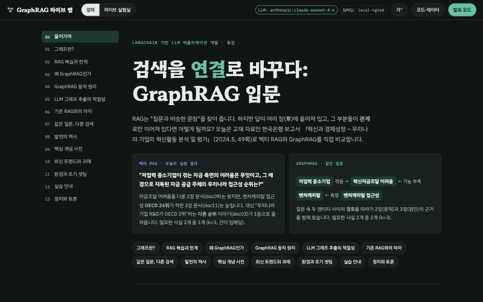
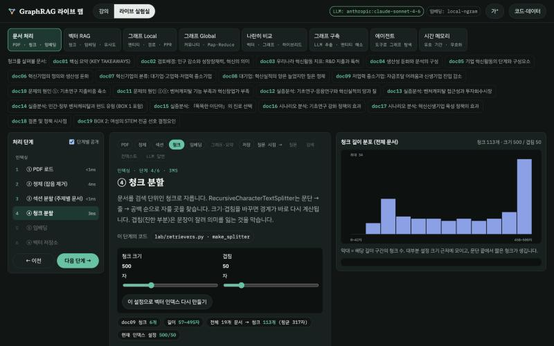
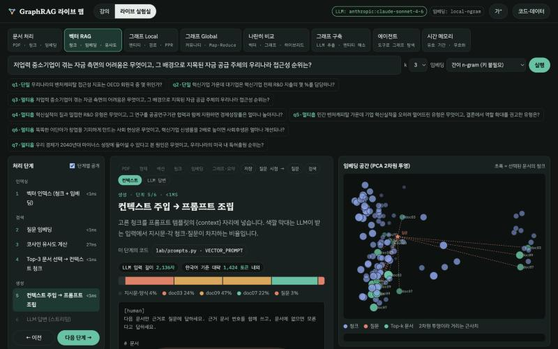
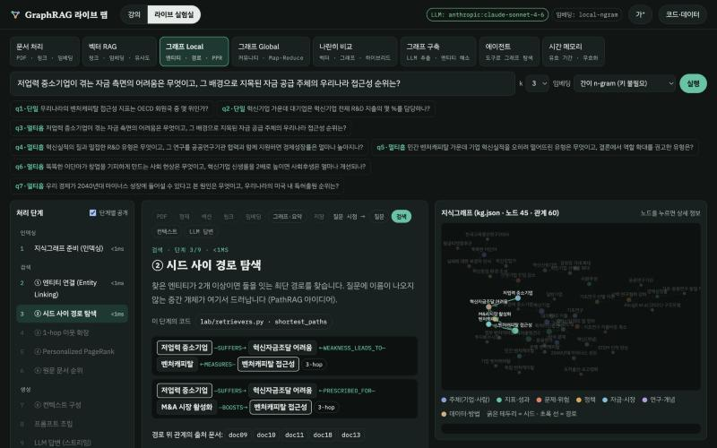

# GraphRAG 라이브 랩

**문서 처리부터 벡터 RAG·GraphRAG까지, 각 처리 단계에서 무슨 일이 일어나는지 실시간으로 펼쳐 보는 LangChain 강의·실습 시스템**

학부 "LangChain 기반 LLM 애플리케이션 개발" 수업의 GraphRAG 특강용으로 만들었습니다. (삼육대학교 일반대학원 인공지능융합학부 정진수, 지도교수 류한철)
한국은행 보고서 「혁신과 경제성장 – 우리나라 기업의 혁신활동 분석 및 평가」(2024.5) 한 편을 실습 자료로,
같은 질문을 벡터 RAG와 GraphRAG로 돌려 보며 **청크·임베딩·유사도·엔티티 연결·경로·PageRank·프롬프트·LLM 답변**을 단계별로 보여 줍니다.

[English README](README.md)

화면 상단 **KO | EN** 버튼으로 강의·실험실·데이터 전체를 한국어/영어로 바꿀 수 있습니다. 영어는 같은 보고서의 한국은행 공식 영문판(*Innovation and Economic Growth: Review of Korean Firms' Innovation Performance*)으로 만든 별도 데이터를 씁니다.



| 문서 처리: 청크 크기·겹침을 바꾸면 경계가 즉시 다시 그려짐 | 벡터 RAG: 프롬프트에서 출처별 비율 |
|---|---|
|  |  |

| 그래프 RAG: 질문 속 두 개념을 잇는 경로 탐색 |
|---|
|  |

## 주요 기능

- **강의 화면**: 그래프 기초 → RAG의 한계 → GraphRAG 원리 → LLM 그래프 추출의 적절성 → 벡터 RAG와의 비교 → 발전사 → 개념 사전 → 최신 트렌드 → 환경 셋팅. `발표 모드`로 한 장씩 넘기며 발표하고, 곳곳의 **▶ 실험실** 버튼으로 해당 질문을 바로 실행합니다.
- **라이브 실험실**: 서버가 `lab/`의 실습 코드를 그대로 import 해서 실행하고, 단계마다 입력·출력·소요 시간을 돌려줍니다.

| 모드 | 단계별로 보여 주는 것 |
|---|---|
| 문서 처리 | PDF 로드(페이지별 글자 수) → 정제(지운 줄과 이유) → 섹션 분할 → 청크 분할(크기·겹침 슬라이더) → 임베딩(히트맵·산점도) → 벡터 저장소 |
| 벡터 RAG | 질문 임베딩 → 전체 청크 코사인 유사도·PCA 산점도 → Top-k 컨텍스트 → 프롬프트 구성 비율 → LLM 스트리밍(답변 속 출처) |
| 그래프 Local | 엔티티 연결 → 시드 간 경로 → 1-hop 확장 → Personalized PageRank → 문서 순위 → 컨텍스트 → LLM |
| 그래프 Global | 커뮤니티 탐지 → 커뮤니티 리포트 → Map → Reduce → LLM |
| 나란히 비교 | 벡터·그래프·하이브리드 검색 결과와 Recall, 두 방식 LLM 답변 동시 생성, 실시간 벤치마크 |
| 그래프 구축 | 추출 프롬프트·JSON 스키마 → LLM 추출 → 엔티티 해소(기존 그래프와 병합) |
| 에이전트 | LLM이 그래프 탐색 도구를 골라 쓰는 과정을 실시간 표시 |
| 시간 메모리 | 유효 기간이 있는 사실, 모순된 옛 사실의 무효화, 시점별 질의 |

- 모든 단계 위의 **파이프라인 지도**가 전체 흐름에서 현재 위치를 표시하고, **이 단계의 코드** 버튼은 실제 소스의 해당 함수 줄을 강조해 엽니다.
- **API 키가 없어도** 검색·그래프 단계는 모두 실제로 실행됩니다. LLM 호출 단계만 비활성화됩니다.

## 설치

Python 3.10 이상이 필요합니다 (macOS: `brew install python@3.12`).

```bash
git clone https://github.com/JinsuChung/graphrag-live-lab.git
cd graphrag-live-lab
python3.12 -m venv .venv
.venv/bin/pip install -r requirements.txt
.venv/bin/pip install langchain-huggingface sentence-transformers   # 선택: 로컬 한국어 임베딩(e5)
cp .env.example .env                                                 # 선택: LLM 설정
```

Windows에서는 `.venv\Scripts\pip`, `.venv\Scripts\python`을 쓰세요.

## 실행

```bash
./start.command                  # macOS는 Finder에서 더블클릭해도 됨 → http://localhost:8000
```

Windows는 `.venv\Scripts\python app\server.py`로 실행합니다.

- **처음 실행할 때**(언어별로 한 번) 한국은행 홈페이지의 공식 링크에서 보고서 PDF를 받아 `data/<언어>/docs`에 주제별 문서 19개를 만듭니다. 자동으로 받지 못하면 화면에 안내되는 게시물에서 직접 받아 `data/source/`에 넣으세요.
- 기본 언어는 `.env`의 `DATA_LANG`(ko | en)이고, 화면의 **KO | EN** 버튼으로 언제든 바꿀 수 있습니다. 언어는 서버 전체에 적용되어 접속한 모든 사람이 같은 언어를 봅니다.
- 같은 네트워크의 학생 노트북에서 접속하게 하려면 `HOST=0.0.0.0 ./start.command`로 실행합니다. 포트를 바꾸려면 `PORT=8010 ./start.command`.
- 터미널 실습: `.venv/bin/python lab/00_prepare_pdf.py` 처럼 `lab/` 안의 스크립트를 순서대로 실행합니다. VS Code나 Jupyter에서는 `# %%` 셀 단위로 실행할 수 있습니다.

## LLM 설정 (`.env`)

```
DATA_LANG=ko                            # ko | en
LLM_MODEL=anthropic:claude-sonnet-4-6   # LangChain init_chat_model 형식 <provider>:<model>
LLM_TEMPERATURE=0                       # temperature 를 받지 않는 모델이면 비워 둠
ANTHROPIC_API_KEY=...
EXTRACTOR=custom                        # 실습 03: custom(구조화 출력 직접 구현) | lgt(교재 방식 LLMGraphTransformer)
EMBEDDING_MODEL=local-ngram             # local-ngram | huggingface:intfloat/multilingual-e5-small | openai:text-embedding-3-small
```

교재 설정(`gpt-4o`, temperature 0)을 대신할 최신 모델로 temperature를 지원하는 Claude Sonnet 4.6을 기본값으로 두었습니다.
2026년 9월 기준으로 Claude 5세대, GPT-6 Astra 등 최신 추론 모델은 temperature를 받지 않거나 제한적으로만 받습니다(강의 화면 "LLM 그래프 추출의 적절성" 참고).

## 실습 스크립트

| 파일 | 내용 | LLM |
|---|---|---|
| `00_prepare_pdf.py` | PDF 내려받기 → 정제 → 주제별 문서 19개 | ✗ |
| `01_graph_basics.py` | 노드·엣지, 경로, PageRank, 커뮤니티 | ✗ |
| `02_vector_rag.py` | 기본 벡터 RAG (LCEL) | 선택 |
| `03_build_graph.py` | LLM 지식그래프 추출(교재 방식/직접 구현) + 참조 그래프와 비교 | **필요** |
| `04_local_graph_rag.py` | Local Search (엔티티 연결·경로·PPR) | 선택 |
| `05_global_graph_rag.py` | Global Search (커뮤니티 리포트 Map-Reduce) | 선택 |
| `06_compare_eval.py` | 벡터 vs 그래프 vs 하이브리드 Recall@k | ✗ |
| `07_neo4j_text2cypher.py` | Neo4j 적재·Cypher·Text2Cypher (`docker compose up -d` 또는 AuraDB) | 선택 |
| `08_agentic_graph_rag.py` | 에이전트가 그래프 도구로 탐색 | 선택 |
| `09_temporal_memory.py` | 시간 인식 지식그래프 | ✗ |

## 결과 요약

**검색 Recall** (질문 q1~q7 평균, 청크 500자·겹침 50자, 사실별 근거 그룹 기준)

| 임베딩 | k | vector | graph | hybrid |
|---|---|---|---|---|
| local-ngram | 3 | 0.93 | 0.93 | 0.93 |
| local-ngram | 5 | 0.93 | 0.93 | 1.00 |
| multilingual-e5-small | 3 | 0.93 | 0.93 | 0.86 |
| multilingual-e5-small | 5 | 0.93 | 0.93 | 0.93 |

- 보고서 한 편에서는 질문과 본문의 표현이 많이 겹쳐 **벡터 검색이 이미 강합니다**. "GraphRAG가 항상 이긴다"는 사실이 아닙니다.
- 그래프는 **두 개념을 잇는 근거가 다른 장에 있을 때(q3)** 이깁니다. 실제 LLM 답변에서 벡터 RAG는 "접근성 순위는 모른다"고 답했고, 그래프 RAG는 경로를 따라 "벤처캐피탈 접근성 OECD 24위"까지 답했습니다.
- 엔티티 이름 없이 위치를 가리키는 질문(q5 "결론에서 권고한 유형")은 둘 다 놓칩니다 → 에이전트 방식의 동기.
- 영문판 데이터에서는 벡터 검색이 더 약했습니다(local-ngram k=3에서 vector 0.64, graph 0.93). 표 전체는 [English README](README.md#results)에 있습니다.
- 같은 설정이면 몇 번을 돌려도 결과가 같습니다(Louvain 시드 고정, 최단 경로 정렬, scipy 버전 고정).

**LLM 그래프 추출** (Claude Sonnet 4.6, temperature 0, 문서 19개)

| 방식 | 노드 | 관계 | 관계 이름 종류 | 참조 관계 재현율 |
|---|---|---|---|---|
| 참조 그래프 `data/ko/kg.json` | 45 | 60 | 36 | – |
| 직접 구현 (Pydantic 구조화 출력) | 163 | 300 | 106 | 37% |
| 교재 방식 (LLMGraphTransformer) | 256 | 478 | 158 | 28% |

같은 문서 3개를 같은 설정으로 두 번 추출했을 때 트리플 일치도(자카드)는 0.11~0.42였습니다. temperature 0이 같은 결과를 보장하지 않습니다.
추출 결과는 `data/<언어>/kg_extracted_custom.json`, `kg_extracted_lgt.json`에 있어 키 없이도 비교할 수 있습니다. 영문판 결과(직접 구현 202/323/142종/25%, 교재 방식 265/542/214종/33%)도 함께 들어 있습니다.

## 폴더 구조

```
app/        라이브 실험실 (FastAPI 서버, 단계 추적기, 강의·실험실 화면)
  static/lecture.ko.html, lecture.en.html   언어별 강의 내용
lab/        실습 코드 — 서버와 터미널 스크립트가 함께 사용
  pdf_prep.py       PDF 내려받기 → 로드(PyPDFLoader) → 정제(국문판: 글자 규칙, 영문판: 글꼴 크기) → 섹션 분할
  retrievers.py     벡터 / 그래프 / 하이브리드 검색 (단계별 상세 결과 포함)
  extraction.py     LLM 그래프 추출(구조화 출력, LLMGraphTransformer), 엔티티 해소, 그래프 비교
  global_search.py  커뮤니티 탐지, 리포트, Map-Reduce
  graph_tools.py    에이전트용 그래프 도구
  temporal_kg.py    시간 인식 지식그래프
  00~09_*.py        터미널용 실습 스크립트
data/
  ko/, en/                    판(언어)별 데이터
    kg.json                   참조 지식그래프 (노드 45, 관계 60, 관계마다 출처 문서)
    questions.json            평가 질문 8개 + 사실별 근거 그룹
    community_summaries.json  Global Search용 커뮤니티 리포트 7개
    kg_extracted_*.json       LLM 추출 결과 (위 표)
    docs/                     처음 실행 시 생성 (저장소에는 없음)
  source/                     내려받은 PDF (저장소에는 없음)
notes/      GraphRAG 개념 정리 노트
```

## 자료 출처와 저작권

- 실습 자료: 한국은행, 「경제전망보고서(2024년 5월)」 III. 중장기 심층연구 「혁신과 경제성장 – 우리나라 기업의 혁신활동 분석 및 평가」(경제연구원 미시제도연구실). [국문판 게시물](https://www.bok.or.kr/portal/bbs/P0002359/view.do?nttId=10084275&menuNo=200066) · [영문판 게시물](https://www.bok.or.kr/imerEng/bbs/B0000519/view.do?nttId=10086298&menuNo=600379)
- 보고서의 저작권은 한국은행에 있습니다. [한국은행 저작권보호방침](https://www.bok.or.kr/portal/main/contents.do?menuNo=200228)에 따라 이 저장소에는 PDF와 본문 텍스트를 넣지 않고, 실행 시 공식 링크에서 내려받습니다.
- `data/<언어>/kg.json`·`questions.json`·`community_summaries.json`은 보고서의 수치와 내용을 요약해 이 프로젝트에서 작성한 것입니다. 참조 그래프는 LLM 자동 추출이 아니라 AI 어시스턴트가 원문을 읽고 핵심 관계만 골라 정리했고, 핵심 수치는 원문과 대조했습니다. 영문 그래프는 국문 그래프와 노드 단위로 일대일 대응합니다. 수업에 쓰기 전 검토를 권장합니다.

## 만든 사람

- 제작: 정진수 ([GitHub](https://github.com/JinsuChung))
- 지도교수: 류한철
- 소속: 삼육대학교 일반대학원 인공지능융합학부

## 라이선스

코드와 이 프로젝트에서 작성한 자료는 [MIT License](LICENSE)를 따릅니다. 한국은행 보고서는 이 라이선스의 대상이 아닙니다.
