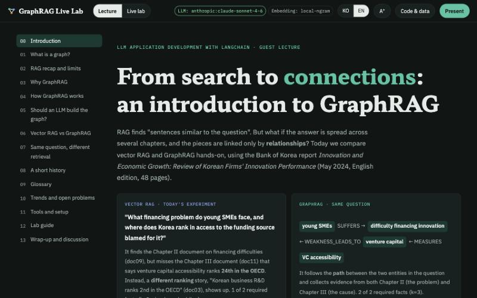
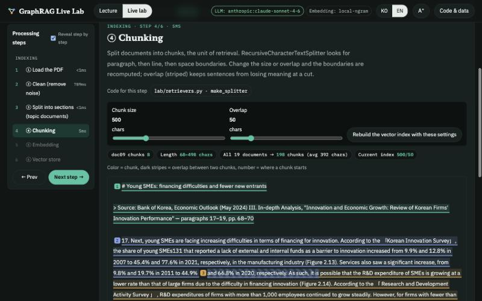
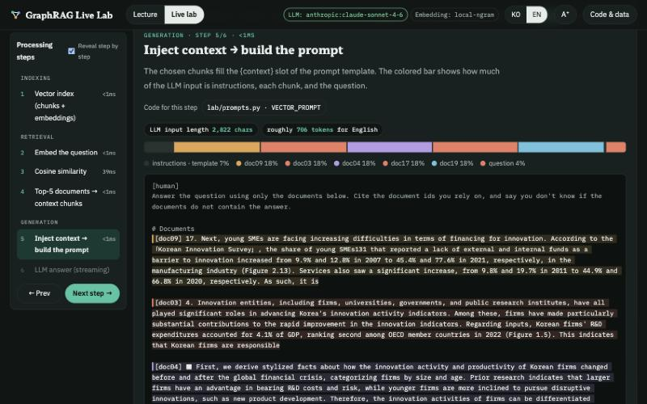
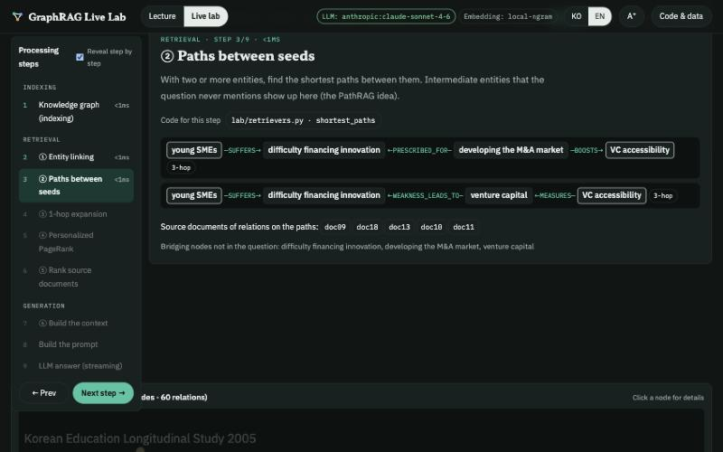

# GraphRAG Live Lab

**A live teaching lab that unfolds, step by step, what actually happens inside vector RAG and GraphRAG, from PDF processing to the LLM answer, built with LangChain.**

[한국어 README](README.ko.md)

Built for a GraphRAG guest lecture in the undergraduate course "LLM Application Development with LangChain" (정진수, Sahmyook University Graduate School, Division of AI Convergence; advisor: 류한철).
Using a single Bank of Korea report, *Innovation and Economic Growth: Review of Korean Firms' Innovation Performance* (May 2024), it runs the same question through vector RAG and GraphRAG and shows **chunks, embeddings, similarity, entity linking, paths, PageRank, prompts and LLM answers** one step at a time.

The whole system is bilingual: switch with the **KO | EN** button at the top. Each language has its own data set built from the matching official edition of the report (Korean edition / English edition).



| Documents: change chunk size and overlap and the boundaries are redrawn instantly | Vector RAG: what share of the prompt each source takes |
|---|---|
|  |  |

| GraphRAG: paths connecting the two concepts in the question |
|---|
|  |

## Features

- **Lecture**: graph basics → limits of RAG → how GraphRAG works → should an LLM build the graph? → vector RAG vs GraphRAG → history → glossary → recent trends → tools and setup. Present one section at a time with `Present`, and run the relevant question right away with the **▶ Lab** buttons throughout.
- **Live lab**: the server imports and runs the lab code in `lab/` as is, and returns the inputs, outputs and timing of every step.

| Mode | What it shows step by step |
|---|---|
| Documents | Load PDF (characters per page) → clean (removed lines and why) → split sections → split chunks (size/overlap sliders) → embed (heatmap, scatter plot) → vector store |
| Vector RAG | Embed the question → cosine similarity for all chunks, PCA scatter → top-k context → prompt composition → LLM streaming (sources in the answer) |
| Graph Local | Entity linking → paths between seeds → 1-hop expansion → Personalized PageRank → document ranking → context → LLM |
| Graph Global | Community detection → community reports → map → reduce → LLM |
| Side by side | Vector, graph and hybrid results and recall, both LLM answers at once, live benchmark |
| Build graph | Extraction prompt and JSON schema → LLM extraction → entity resolution (merge with the existing graph) |
| Agent | Watch an LLM choose graph exploration tools in real time |
| Temporal memory | Facts with validity periods, invalidation of contradicted facts, point-in-time queries |

- A **pipeline map** above every step marks where you are in the overall flow, and the **Code for this step** button opens the real source with the function's lines highlighted.
- **Without an API key**, every retrieval and graph step still runs for real. Only the LLM steps are disabled.

## Install

Requires Python 3.10+ (macOS: `brew install python@3.12`).

```bash
git clone https://github.com/JinsuChung/graphrag-live-lab.git
cd graphrag-live-lab
python3.12 -m venv .venv
.venv/bin/pip install -r requirements.txt
.venv/bin/pip install langchain-huggingface sentence-transformers   # optional: local multilingual embeddings (e5)
cp .env.example .env                                                 # optional: LLM settings, DATA_LANG=en
```

On Windows use `.venv\Scripts\pip` and `.venv\Scripts\python`.

## Run

```bash
DATA_LANG=en ./start.command     # on macOS you can also double-click it in Finder → http://localhost:8000
```

On Windows: `set DATA_LANG=en` then `.venv\Scripts\python app\server.py`.

- **On first run** (per language) the report PDF is downloaded from the Bank of Korea's official link and turned into 19 topic documents in `data/<lang>/docs`. If the download fails, get the PDF from the page shown in the error message and put it in `data/source/`.
- `DATA_LANG` only sets the default. The **KO | EN** button switches the data and UI at any time (the language is server-wide, so everyone connected sees the same one).
- To let students on the same network connect: `HOST=0.0.0.0 ./start.command`. To change the port: `PORT=8010 ./start.command`.
- Terminal labs: run the scripts in `lab/` in order, e.g. `DATA_LANG=en .venv/bin/python lab/00_prepare_pdf.py`. In VS Code or Jupyter you can run them cell by cell (`# %%`).

## LLM settings (`.env`)

```
DATA_LANG=en                            # en | ko
LLM_MODEL=anthropic:claude-sonnet-4-6   # LangChain init_chat_model format <provider>:<model>
LLM_TEMPERATURE=0                       # leave empty for models that reject temperature
ANTHROPIC_API_KEY=...
EXTRACTOR=custom                        # Lab 03: custom (own structured-output code) | lgt (textbook LLMGraphTransformer)
EMBEDDING_MODEL=local-ngram             # local-ngram | huggingface:intfloat/multilingual-e5-small | openai:text-embedding-3-small
```

The textbook uses `gpt-4o` at temperature 0; the default here is Claude Sonnet 4.6, a recent model that still supports temperature.
As of September 2026, the newest reasoning models (Claude 5th generation, GPT-6 Astra, etc.) reject temperature or accept it only in limited modes (see "Should an LLM build the graph?" in the lecture).

## Lab scripts

| File | Contents | LLM |
|---|---|---|
| `00_prepare_pdf.py` | Download PDF → clean → 19 topic documents | ✗ |
| `01_graph_basics.py` | Nodes and edges, paths, PageRank, communities | ✗ |
| `02_vector_rag.py` | Basic vector RAG (LCEL) | optional |
| `03_build_graph.py` | LLM knowledge-graph extraction (textbook / custom) + comparison with the reference graph | **required** |
| `04_local_graph_rag.py` | Local Search (entity linking, paths, PPR) | optional |
| `05_global_graph_rag.py` | Global Search (map-reduce over community reports) | optional |
| `06_compare_eval.py` | Vector vs graph vs hybrid Recall@k | ✗ |
| `07_neo4j_text2cypher.py` | Load into Neo4j, Cypher, Text2Cypher (`docker compose up -d` or AuraDB) | optional |
| `08_agentic_graph_rag.py` | An agent explores the graph with tools | optional |
| `09_temporal_memory.py` | Time-aware knowledge graph | ✗ |

## Results

**Retrieval recall** (average over q1–q7, 500-char chunks with 50 overlap, scored by per-fact evidence groups)

| Data | Embedding | k | vector | graph | hybrid |
|---|---|---|---|---|---|
| English | local-ngram | 3 | 0.64 | 0.93 | 0.86 |
| English | local-ngram | 5 | 0.79 | 0.93 | 0.93 |
| English | multilingual-e5-small | 3 | 0.79 | 0.93 | 0.93 |
| English | multilingual-e5-small | 5 | 0.93 | 0.93 | 0.93 |
| Korean | local-ngram | 3 | 0.93 | 0.93 | 0.93 |
| Korean | local-ngram | 5 | 0.93 | 0.93 | 1.00 |
| Korean | multilingual-e5-small | 3 | 0.93 | 0.93 | 0.86 |
| Korean | multilingual-e5-small | 5 | 0.93 | 0.93 | 0.93 |

- On a single report the questions share a lot of wording with the text, so **vector search is already strong**, especially with a good embedding model and larger k. "GraphRAG always wins" is not true.
- The graph wins **when the evidence linking two concepts in the question is in another chapter (q3)**. Vector search is drawn to the words "Korea · OECD · rank" and picks a chunk about business R&D ranking 2nd; the graph follows the path young SMEs → difficulty financing innovation → venture capital → VC accessibility, and the LLM answers "24th among OECD members".
- Questions that point to a location rather than naming an entity (q5, "the types the conclusion recommends") are missed by both → the motivation for agents.
- Results are identical across runs (fixed Louvain seed, sorted shortest paths, pinned scipy).

**LLM graph extraction** (Claude Sonnet 4.6, temperature 0, 19 documents)

| Data | Method | Nodes | Relations | Relation types | Reference relation recall |
|---|---|---|---|---|---|
| both | Reference graph `data/<lang>/kg.json` | 45 | 60 | 36 | – |
| English | Custom (Pydantic structured output) | 202 | 323 | 142 | 25% |
| English | Textbook (LLMGraphTransformer) | 265 | 542 | 214 | 33% |
| Korean | Custom (Pydantic structured output) | 163 | 300 | 106 | 37% |
| Korean | Textbook (LLMGraphTransformer) | 256 | 478 | 158 | 28% |

Extracting the same three documents twice with identical settings gave triple overlap (Jaccard) of only 0.11–0.42: temperature 0 does not guarantee identical output.
The results are saved in `data/<lang>/kg_extracted_custom.json` and `kg_extracted_lgt.json`, so you can compare them without a key.

## Project layout

```
app/        Live lab (FastAPI server, step tracer, lecture and lab UI)
  static/lecture.ko.html, lecture.en.html   lecture content per language
lab/        Lab code, shared by the server and the terminal scripts
  pdf_prep.py       Download PDF → load (PyPDFLoader) → clean → split sections (Korean: text rules, English: font sizes)
  retrievers.py     Vector / graph / hybrid retrieval (with detailed per-step results)
  extraction.py     LLM graph extraction (structured output, LLMGraphTransformer), entity resolution, graph comparison
  global_search.py  Community detection, reports, map-reduce
  graph_tools.py    Graph tools for the agent
  temporal_kg.py    Time-aware knowledge graph
  00~09_*.py        Terminal lab scripts
data/
  en/, ko/                    One data set per language edition
    kg.json                   Reference knowledge graph (45 nodes, 60 relations, source document per relation)
    questions.json            8 evaluation questions + per-fact evidence groups
    community_summaries.json  7 community reports for Global Search
    kg_extracted_*.json       LLM extraction results (table above)
    docs/                     Created on first run (not in the repository)
  source/                     Downloaded PDFs (not in the repository)
notes/      GraphRAG concept notes (Korean)
```

## Source material and copyright

- Lab material: Bank of Korea, *Innovation and Economic Growth: Review of Korean Firms' Innovation Performance* (Economic Research Institute, May 2024). [English edition](https://www.bok.or.kr/imerEng/bbs/B0000519/view.do?nttId=10086298&menuNo=600379) · [Korean edition](https://www.bok.or.kr/portal/bbs/P0002359/view.do?nttId=10084275&menuNo=200066) (Monetary Policy Report, May 2024, Chapter III)
- The copyright of the report belongs to the Bank of Korea. Following the [Bank of Korea copyright policy](https://www.bok.or.kr/portal/main/contents.do?menuNo=200228), this repository contains neither the PDFs nor their text; they are downloaded from the official links at run time.
- `kg.json`, `questions.json` and `community_summaries.json` were written for this project by summarizing the report's figures and content. The reference graph is not raw LLM extraction: an AI assistant read the report and hand-picked the key relations, and key figures were checked against the source. The English graph mirrors the Korean one node for node. Please review before using it in class.

## Authors

- Author: 정진수 ([GitHub](https://github.com/JinsuChung))
- Advisor: 류한철
- Affiliation: Sahmyook University Graduate School, Division of AI Convergence

## License

The code and the material written for this project are under the [MIT License](LICENSE). The Bank of Korea report is not covered by this license.
